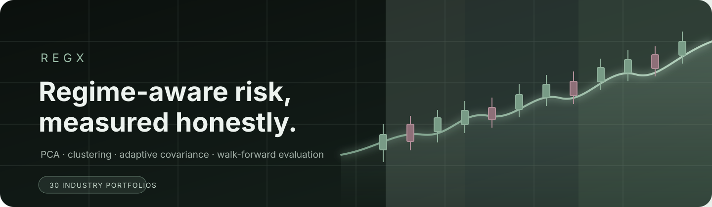

<p align="center">
  
</p>

<p align="center">
  A reproducible quantitative-finance research project comparing traditional and regime-aware covariance estimators across 30 US industry portfolios.
</p>

<p align="center">
  <a href="#quick-start">Quick start</a> ·
  <a href="#research-design">Research design</a> ·
  <a href="#results">Results</a> ·
  <a href="reports/RegX_Research_Report.md">Full report</a> ·
  <a href="dashboard/README.md">Dashboard guide</a>
</p>

## Overview

RegX asks a focused research question:

> Does PCA- and clustering-guided regime awareness improve adaptive covariance
> estimation and portfolio risk management compared with direct feature-based
> adaptation and traditional covariance estimators?

The system cleans the Kenneth French 30 Industry Portfolios dataset, builds
market-state features, studies common movement through PCA, identifies market
regimes with K-Means, estimates covariance using six competing approaches, and
evaluates constrained portfolios in a walk-forward backtest.

The project is designed for research and education—not live trading or investment
advice.

## At a glance

| Data | Analysis | Evaluation |
|---|---|---|
| 26,317 daily observations | PCA and three K-Means regimes | 6,685 out-of-sample days |
| 30 industry portfolios | Six covariance estimators | Seven portfolio strategies |
| July 1926–August 2026 | 252-day covariance lookback | February 2000–August 2026 |

## Research design

```text
Raw industry returns
        │
        ▼
Data validation and cleaning
        │
        ├── Market-state features
        └── Standardized industry returns
                    │
                    ▼
                PCA (PC1–PC3)
                    │
                    ▼
             K-Means regimes
                    │
                    ▼
Sample · EWMA · Ledoit-Wolf · Fixed Blend · Method A · Method B
                    │
                    ▼
       Long-only minimum-variance portfolios
                    │
                    ▼
          Walk-forward performance evaluation
```

### Compared strategies

| Strategy | Purpose |
|---|---|
| Equal Weight | Allocation benchmark |
| Sample | Historical sample covariance |
| EWMA | Recency-weighted covariance with decay 0.94 |
| Ledoit-Wolf | Shrinkage covariance benchmark |
| Fixed Blend | 50/50 EWMA and Ledoit-Wolf blend |
| Method A | Direct feature-based adaptive blend |
| Method B | PCA- and clustering-guided adaptive blend |

Both adaptive methods combine EWMA and Ledoit-Wolf covariance:

```text
Σadaptive = α × ΣEWMA + (1 − α) × ΣLedoitWolf
```

Method B orders the fitted clusters using training-period stress characteristics.
Its alpha levels—`0.30`, `0.50`, and `0.75`—are predefined experimental settings,
not learned optimal parameters. Cluster numbers themselves have no fixed economic
meaning.

## Results

The saved experiment identifies Ledoit-Wolf as the strongest covariance-based
strategy by the project’s reported Sharpe ratio. Method B is the strongest
adaptive approach, but it does not outperform Ledoit-Wolf or sample covariance.
Equal Weight has the highest raw return and final wealth, alongside materially
higher volatility and drawdown.

| Strategy | Annual return | Annual volatility | Reported Sharpe | Final value |
|---|---:|---:|---:|---:|
| Ledoit-Wolf | 9.66% | 15.71% | 0.615 | 11.56 |
| Sample | 9.63% | 15.70% | 0.613 | 11.46 |
| Method B | 9.48% | 15.72% | 0.603 | 11.04 |
| Fixed Blend | 9.40% | 15.71% | 0.598 | 10.85 |
| Method A | 9.32% | 15.74% | 0.592 | 10.63 |
| EWMA | 8.85% | 15.96% | 0.554 | 9.48 |
| Equal Weight | 10.20% | 20.05% | 0.509 | 13.15 |

<p align="center">
  
</p>

<table>
  <tr>
    <td width="50%">
      
    </td>
    <td width="50%">
      
    </td>
  </tr>
  <tr>
    <td align="center"><sub>Portfolio drawdowns</sub></td>
    <td align="center"><sub>Method A and Method B alpha history</sub></td>
  </tr>
</table>

Read the [full research report](reports/RegX_Research_Report.md) for the complete
performance table, interpretation, implementation conventions, and limitations.

## Project structure

```text
RegX/
├── data/
│   ├── raw/                    # Source dataset
│   └── processed/              # Validated return data
├── dashboard/                  # React research dashboard
├── docs/assets/                # Repository visuals
├── figures/performance/        # Generated research charts
├── reports/                    # Research report
├── results/comparisons/        # Backtest and evaluation CSV files
├── main.py                     # End-to-end workflow
├── data.py                     # Loading, cleaning, validation
├── features.py                 # Market features, PCA, clustering
├── covariance.py               # Covariance estimators and adaptation
├── portfolio.py                # Portfolio optimization
├── backtest.py                 # Walk-forward simulation
└── evaluation.py               # Metrics, tables, and figures
```

The seven Python modules are intentionally kept separate so each research stage
is easy to inspect and explain.

## Quick start

### 1. Create and activate an environment

```powershell
python -m venv .venv
.\.venv\Scripts\Activate.ps1
```

If Windows blocks the activation script, the environment can still be used by
calling its Python executable directly in the commands below.

### 2. Install dependencies

```powershell
python -m pip install -r requirements.txt
```

### 3. Confirm the dataset location

```text
data/raw/30_Industry_Portfolios_Daily.csv
```

### 4. Run the complete study

```powershell
python main.py
```

Without activating the environment:

```powershell
.\.venv\Scripts\python.exe main.py
```

The run updates the comparison tables in `results/comparisons/` and the charts
in `figures/performance/`.

## Research dashboard

The dashboard is a static React and Vite application backed by the checked-in
snapshot at `dashboard/public/data/dashboard.json`. It does not require a Python
server. Its workspace covers market features, PCA, regimes, the seven-strategy
portfolio comparison, and industry correlations in one consistent interface.

```powershell
cd dashboard
npm.cmd ci
npm.cmd run dev
```

Open the local address printed by Vite. On Windows, use `npm.cmd` if PowerShell
blocks `npm.ps1`.

To refresh the dashboard after changing the analysis:

```powershell
.\.venv\Scripts\python.exe export_dashboard.py
```

## Vercel deployment

Import this repository into Vercel and use:

| Setting | Value |
|---|---|
| Root Directory | `dashboard` |
| Framework | Vite |
| Build Command | `npm run build` |
| Output Directory | `dist` |

No environment variables or backend service are required. The detailed process
is documented in the [dashboard deployment guide](dashboard/README.md).

## Reproducibility notes

- K-Means uses a fixed random seed of `42`.
- Method B’s PCA, scaling, and clustering models are fitted only on pre-test data.
- All strategies use the same data and out-of-sample dates.
- Minimum-variance portfolios are long-only, fully invested, and capped at 10%
  per industry.
- Weak or negative comparative results are retained; RegX does not claim that
  regime awareness dominates every traditional estimator.

## Documentation and outputs

- [Research report](reports/RegX_Research_Report.md)
- [Dashboard guide](dashboard/README.md)
- [Final performance summary](results/comparisons/final_performance_summary.csv)
- [Backtest returns](results/comparisons/backtest_returns.csv)
- [Turnover history](results/comparisons/turnover.csv)
- [Adaptive regime history](results/comparisons/adaptive_history.csv)

## License and attribution

The dashboard’s third-party UI adaptations are documented in
[THIRD_PARTY_NOTICES.md](dashboard/THIRD_PARTY_NOTICES.md). The Kenneth French
dataset remains subject to its source provider’s terms and attribution.
