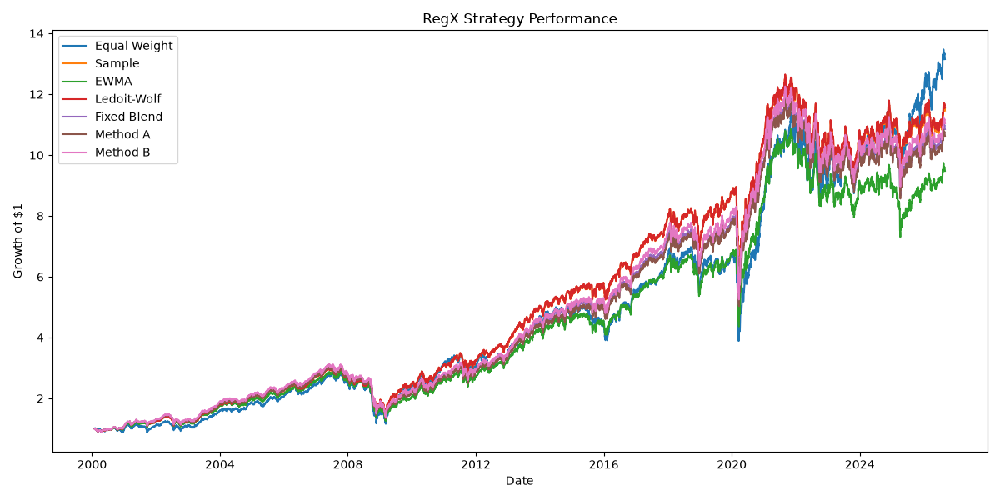
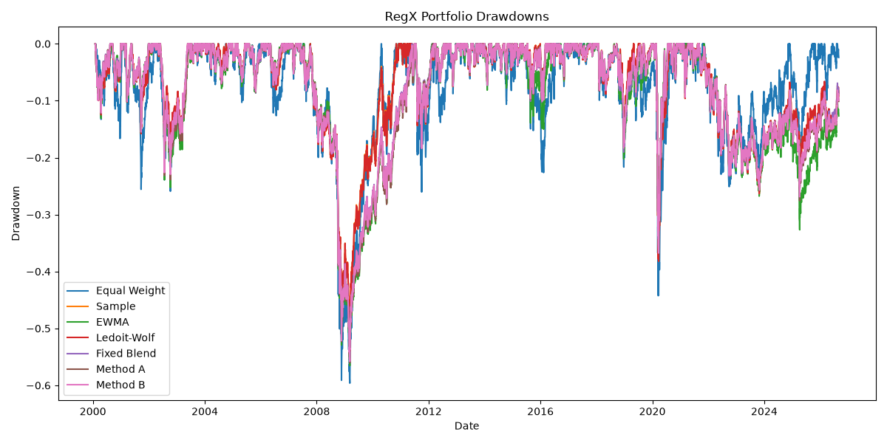
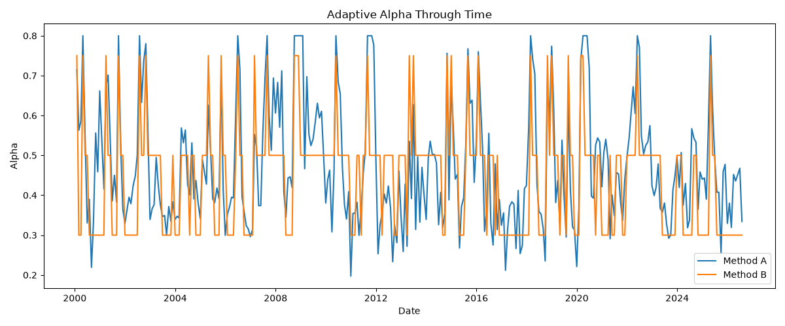

# RegX Research Report

## Regime-Aware Covariance Estimation and Portfolio Risk Management

Report date: 30 October 2026  
Dataset end date: 31 August 2026

## Abstract

RegX studies whether regime awareness based on principal component analysis
(PCA) and K-Means clustering improves adaptive covariance estimation and
portfolio risk management. The experiment uses daily returns for 30 US
industry portfolios and compares seven long-only portfolio strategies over an
out-of-sample period beginning in 2000. The results show that the
clustering-guided Method B is the strongest adaptive method in this experiment,
but it does not outperform the Ledoit-Wolf or sample covariance strategies.
Equal Weight produces the highest raw return and final wealth, but with
substantially higher volatility and a lower reported Sharpe ratio. The findings
support a cautious conclusion: regime information improves the adaptive design,
but stable traditional covariance estimators remain stronger overall under the
current setup.

## Research question

> Does PCA- and clustering-guided regime awareness improve adaptive covariance
> estimation and portfolio risk management compared with direct feature-based
> adaptation and traditional covariance estimators?

## Data

The project uses the Kenneth French 30 Industry Portfolios daily return
dataset. The loader identifies the daily table, parses `YYYYMMDD` dates,
removes duplicates, handles the documented missing-value codes, and converts
percentage returns to decimals.

| Property | Value |
|---|---:|
| Observations | 26,317 |
| Industries | 30 |
| Start date | 1 July 1926 |
| End date | 31 August 2026 |
| Missing values after cleaning | 0 |
| Duplicate dates after cleaning | 0 |
| Minimum daily industry return | -52.97% |
| Maximum daily industry return | 111.85% |

## Methodology

### Market-state features

RegX constructs an equal-weight market return and the following state
variables:

- 20-day and 252-day volatility;
- volatility shock and 20-day volatility change;
- average 60-day cross-industry correlation;
- correlation shift relative to a 252-day baseline; and
- covariance instability, measured as the Frobenius distance between recent
  60-day and longer 252-day covariance matrices.

### PCA and clustering

PCA is applied to standardized industry returns. In the exploratory full-sample
analysis, PC1 explains 60.07% of variance and the first five components explain
71.20% cumulatively. Method B uses PC1-PC3 together with the five market-state
features in a three-cluster K-Means model.

For the backtest, the PCA scaler, PCA model, clustering scaler, and K-Means
model are fitted only on observations ending on 31 December 1999. They are then
held fixed during the out-of-sample simulation. This prevents test-period data
from being used to fit the regime model.

Cluster numbers have no permanent economic meaning. Their ordering is inferred
from pre-test cluster averages for volatility shock, average correlation, and
covariance instability. The resulting final mapping is:

| Cluster | Predefined EWMA weight, alpha | Out-of-sample detections |
|---:|---:|---:|
| 0 | 0.30 | 127 |
| 2 | 0.50 | 162 |
| 1 | 0.75 | 30 |

The alpha values 0.30, 0.50, and 0.75 are predefined experimental settings.
They are not learned optimal parameters.

### Covariance estimators and portfolios

The experiment compares:

1. Equal Weight;
2. sample covariance;
3. EWMA covariance with decay 0.94;
4. Ledoit-Wolf shrinkage;
5. a fixed 50/50 EWMA and Ledoit-Wolf blend;
6. Method A, a direct feature-based adaptive blend; and
7. Method B, a clustering-guided adaptive blend.

Both adaptive methods use:

`Sigma_adaptive = alpha × Sigma_EWMA + (1 - alpha) × Sigma_LedoitWolf`

The covariance-based strategies use long-only minimum-variance portfolios.
Weights sum to one and no industry may exceed 10%. SLSQP solves the constrained
optimization after covariance scaling for numerical stability.

### Backtest design

The final simulation uses a 252-trading-day covariance lookback, month-end
rebalancing decisions, a test start of 1 January 2000, and a transaction-cost
rate of 0.10% per unit of the project-defined turnover measure. The saved
out-of-sample return series contains 6,685 daily observations from 1 February
2000 through 31 August 2026.

## Results

The following table reproduces the saved final performance summary. Values are
net of the transaction-cost deductions implemented by the backtest.

| Strategy | Annual return | Annual volatility | Reported Sharpe | Max drawdown | Avg. turnover | Cost proxy | Final value |
|---|---:|---:|---:|---:|---:|---:|---:|
| Ledoit-Wolf | 9.66% | 15.71% | 0.615 | -52.52% | 0.115 | 0.0366 | 11.56 |
| Sample | 9.63% | 15.70% | 0.613 | -52.46% | 0.117 | 0.0373 | 11.46 |
| Method B | 9.48% | 15.72% | 0.603 | -55.78% | 0.290 | 0.0926 | 11.04 |
| Fixed Blend | 9.40% | 15.71% | 0.598 | -55.70% | 0.312 | 0.0995 | 10.85 |
| Method A | 9.32% | 15.74% | 0.592 | -56.05% | 0.308 | 0.0984 | 10.63 |
| EWMA | 8.85% | 15.96% | 0.554 | -56.54% | 0.526 | 0.1678 | 9.48 |
| Equal Weight | 10.20% | 20.05% | 0.509 | -59.62% | 0.000 | 0.0000 | 13.15 |







## Interpretation

Ledoit-Wolf is the strongest covariance-based strategy by the reported Sharpe
ratio and final value, with sample covariance very close behind. Their average
turnover is much lower than that of all adaptive and EWMA-heavy strategies.

Method B is the strongest adaptive method. It exceeds Method A, Fixed Blend,
and EWMA on annual return, reported Sharpe ratio, turnover, cost proxy, and final
value. This supports the narrower claim that PCA- and clustering-guided regime
classification improves the adaptive approach used in RegX.

The stronger claim that regime awareness beats all traditional estimators is
not supported. Method B remains behind both Ledoit-Wolf and sample covariance.
The experiment therefore suggests that regime information is useful, but does
not eliminate the value of stable covariance estimation.

Equal Weight has the highest annual return and final value, but also the highest
volatility and deepest drawdown. It answers a different practical trade-off:
greater raw growth was obtained with materially greater risk.

## Implementation conventions and limitations

The following points should be stated in a dissertation, presentation, or viva
so that the results are not overstated:

- The current return calculation applies each month-end target weight vector to
  every daily return in the following month. This is a constant-weight
  convention; it does not explicitly model within-month weight drift.
- Turnover is the full sum of absolute changes between consecutive target
  vectors. It does not use drifted pre-trade weights or the alternative one-way
  convention of half the absolute change. The reported cost proxy must therefore
  be interpreted using the project's own definition.
- The reported Sharpe ratio is CAGR divided by annualized volatility with an
  implicit zero risk-free rate. It is not the conventional annualized arithmetic
  mean-return Sharpe calculation.
- The first portfolio allocation is assigned zero turnover and no initial
  transaction cost.
- Method A is a transparent heuristic based on manually specified coefficients;
  its coefficients are not estimated or optimized.
- Method B uses a regime model fitted once before the test period. This is
  leakage-safe, but the model cannot adapt its cluster centers to later structural
  change. Periodic refitting would be a separate robustness experiment.
- K-Means cluster labels are arbitrary. Only the training-period severity
  ranking gives them an economic ordering.
- The analysis covers 30 aggregated US industry portfolios, not individual
  securities, international markets, taxes, market impact, or live execution.
- Results from one historical sample do not establish that the same ranking will
  hold in future data.

These conventions do not invalidate the comparison, because the strategies are
evaluated consistently within the same implementation. They do limit how the
absolute turnover, cost, and Sharpe values should be described.

## Conclusion

The evidence answers the research question with a qualified yes. PCA- and
clustering-guided regime awareness improves RegX's adaptive covariance method
relative to direct feature adaptation and the fixed or EWMA-heavy adaptive
benchmarks. It does not consistently outperform the best traditional covariance
estimators. The most defensible conclusion is therefore that regime awareness
adds useful structure to adaptive risk estimation, while Ledoit-Wolf shrinkage
remains the strongest and simplest covariance-based benchmark in this study.

## Reproduction

From the `RegX` directory with the project environment activated:

```powershell
python main.py
```

On Windows, if PowerShell does not resolve the active environment correctly:

```powershell
.\.venv\Scripts\python.exe main.py
```

The run updates the comparison CSV files under `results/comparisons/` and the
three performance figures under `figures/performance/`.
